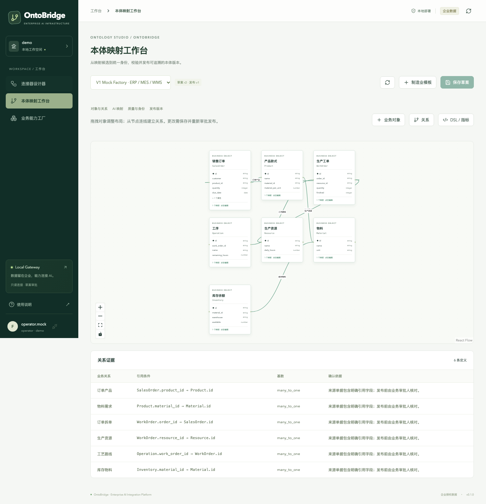
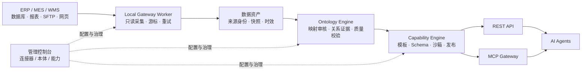

<div align="center">

# OntoBridge

**让遗留系统的数据，成为 AI 可以理解、调用和追溯的业务能力。**

Enterprise AI Integration & Ontology Platform

[](pyproject.toml)
[](gateway/package.json)
[](docs/v1-operations.md)
[](LICENSE)

[快速开始](#quickstart) · [功能概览](#features) · [系统架构](#architecture) · [文档](#docs) · [参与贡献](CONTRIBUTING.md) · [FDE前线](https://fdeopen.com)

**作者：邴越** · 全网：**越哥聊AI** · **FDE前线 / FDEOpen.com**

</div>

---

OntoBridge 是面向制造业、传统企业和 FDE 的 **AI 连接与业务本体平台**。它连接经授权的 ERP / MES / WMS 数据，将分散的销售订单、生产工单、物料和库存映射为统一业务对象，再发布带权限、版本和来源证据的 REST API 与 MCP 工具。

从数据源到 Agent，一条完整链路：

**连接与同步 → 映射与审核 → 本体与关系 → 能力测试与发布 → Agent 调用与审计。**

> **当前状态**：V1 功能开发及 mock 场景验收已完成。业务数据和默认模型为合成演示；三种真实数据库服务连接已验证。真实企业适配、业务口径和生产性能仍需在目标环境验收，详见 [验收账本](docs/v1-status.md)。
>
> **授权方式**：源码可用，非商业用途可按 [项目许可证](LICENSE) 使用；商业使用须事先取得作者的单独书面授权。本项目采用基于 Apache-2.0 修改的非商业许可，**不是标准 Apache-2.0，也不是 OSI 意义上的开源许可**。

## 看见业务关系，而不只是数据库表



*真实运行截图，使用合成 ERP / MES / WMS 数据。本体中的每条业务关系都有来源字段与确认依据。*

## 为什么做 OntoBridge

企业数据往往已经存在，但 AI 缺少稳定的访问方式和可靠的业务语义：订单分散在 ERP，进度留在 MES，库存又来自另一份报表。

OntoBridge 将这几件事放进同一个可治理的流程：

- **接得进来**：通过只读数据库、文件、SFTP 和授权网页导出接入遗留系统。
- **关联有依据**：保留来源主键、统一身份、关联证据和映射版本，冲突进入人工复核。
- **能力可复用**：将已发布本体封装成业务工具，供问数、交期分析和辅助排产 Agent 共用。
- **结果可核验**：调用附带来源、时效和规则版本；权限不足或数据不可信时拒绝返回业务结论。

适合：实施企业 AI 项目的 FDE、系统集成商、制造业 IT 团队，以及需要业务数据接口的 Agent 开发者。

<a id="features"></a>

## 三个工作台，一条业务链路

| 工作台 | 主要能力 | 输出 |
| --- | --- | --- |
| **Connector Studio · 连接器设计器** | 插件 SDK、结构发现、全量/增量采集、持久化游标、失败重试、网页导出录制与审批、运行告警 | 可追溯的数据资产 |
| **Ontology Studio · 本体映射工作台** | 可视化对象与关系、AI 映射候选、人工审核、身份冲突处理、质量约束、指标、版本发布与回滚 | 经审核的业务本体 |
| **Capability Factory · 业务能力工厂** | 查询模板、入出参 Schema、沙箱测试、动态 REST/MCP、权限策略、调用审计、动作草案 | Agent 可调用的业务能力 |

### 接入方式

| 数据来源 | 当前支持 | 边界 |
| --- | --- | --- |
| PostgreSQL / MySQL / SQL Server | 表结构、类型、主键发现；全量与增量轮询 | 来源只读账号；稳定唯一键与水位 |
| SQLite | 只读文件访问与采集 | 租户来源目录内的授权文件 |
| CSV / Excel | CSV 与 XLSX 工作表导入 | XLSX 静态值；拒绝公式与越界路径 |
| SFTP | 远程报表采集 | 固定 SSH 主机公钥 |
| 网页 ERP | 人工录制、独立审批、受限导出 | 授权网页流程；不支持任意脚本或 Windows 原生客户端 |
| 自定义连接器 | Python entry point 插件 | 可信部署代码，实现统一 Connector 接口 |

### 七种业务能力模板

以下工具名由演示流程生成，实际发布时可配置名称、说明、角色、参数限制及依赖版本。

| 模板 | 演示工具 | 业务用途 |
| --- | --- | --- |
| `entity_lookup` | `read_order` | 按授权范围查询业务对象 |
| `order_360` | `get_order_360` | 订单、工单、进度与来源全景 |
| `delivery_risk` | `check_delivery_risk` | 按确定性规则诊断交期风险 |
| `material_shortage` | `get_material_shortage` | 检查物料需求与可用库存 |
| `production_progress` | `get_production_progress` | 汇总工单与工序进度 |
| `list_due_orders` | `list_due_orders` | 按交期范围筛选订单 |
| `schedule_draft` | `propose_schedule_change` | 生成可审批的排产调整草案 |

动作审批后仍为草案，**不会写回 ERP/MES**。模型只提出映射候选，不能替代审核或直接执行 SQL。

<a id="quickstart"></a>

## 快速开始

### 1. 准备环境

需要 **Python 3.11+**、**uv**、**Node.js 22+** 和 npm。下载或克隆本仓库后，在项目根目录运行以下命令；无需先准备企业数据库或模型密钥。

```bash
uv sync --locked
uv run playwright install chromium
npm --prefix web ci
npm --prefix gateway ci
npm --prefix web run build
```

Linux 缺少浏览器系统依赖时，可按 Playwright 的安装提示运行 `uv run playwright install --with-deps chromium`。

### 2. 启动三个进程

在三个终端中分别执行。以下环境变量语法适用于 macOS / Linux shell；API 与 Worker 使用同一数据目录。

**终端 A · API 与控制台**

```bash
ONTOBRIDGE_DATA=var/v1-console uv run ontobridge --port 8788
```

**终端 B · 采集 Worker**

```bash
ONTOBRIDGE_DATA=var/v1-console uv run ontobridge-worker
```

**终端 C · MCP 网关**

```bash
ONTOBRIDGE_API_URL=http://127.0.0.1:8788 \
ONTOBRIDGE_MCP_PORT=8791 node gateway/server.mjs
```

打开 **[本地控制台](http://127.0.0.1:8788)**。本地演示支持切换工程师、审批人和访客角色；演示模式仅绑定回环地址。

### 3. 跑通订单业务链路

在另一个终端执行：

```bash
uv run python scripts/v1_mock_acceptance.py --url http://127.0.0.1:8788
node gateway/pilot-check.mjs
```

验收脚本通过公开 API 完成采集、映射候选、独立审核、本体发布、能力测试与发布；MCP 检查使用官方新旧客户端验证结果一致性与权限拒绝。

| 演示结果 | 预期值 |
| --- | --- |
| 统一实体 / 来源身份 / 有证据关系 | 52 / 52 / 62 |
| 已发布能力 | 7 个，目录按角色过滤 |
| 示例订单 | `SO-2026-0088` |
| 订单数量 / 已完工 / 关联工单 | 1,200 件 / 864 件 / 2 张 |

所有数据均为合成样例。重跑会创建新的本体和能力版本，并保留历史。

## 接入你的 Agent

REST 与 MCP 共用能力执行、权限和审计逻辑。先完成能力发布，再使用具有相应权限的平台令牌调用。

| 接口 | 用途 |
| --- | --- |
| `GET /api/v1/generated/openapi.json` | 当前角色可见的 OpenAPI 契约 |
| `GET /api/v1/tools` | 当前角色可见的工具目录 |
| `POST /api/v1/invoke/{name}` | 调用已发布能力 |
| MCP `/mcp` | Streamable HTTP 工具入口 |

私有部署的角色令牌位于本机 `var/access.json`，不要提交到仓库或粘贴到公开记录。本机演示的临时登录方式可参考 `gateway/pilot-check.mjs`。将自己的令牌保存在当前终端的 `ONTOBRIDGE_TOKEN` 环境变量后：

```bash
curl --fail-with-body http://127.0.0.1:8788/api/v1/invoke/get_order_360 \
  -H "Authorization: Bearer ${ONTOBRIDGE_TOKEN}" \
  -H 'Content-Type: application/json' \
  --data '{"order_id":"SO-2026-0088"}'
```

响应包含业务 `result` 与 `meta`；后者记录能力版本和来源证据等信息。完整可运行的 MCP 调用示例见 [`gateway/pilot-check.mjs`](gateway/pilot-check.mjs)。

本地演示 MCP 地址为 `http://127.0.0.1:8791/mcp`，私有 Compose 部署默认为 `http://127.0.0.1:8790/mcp`。在支持 Streamable HTTP 的客户端配置 URL 与 `Authorization: Bearer <平台令牌>`。网关支持 MCP `2026-07-28` 协议与旧客户端初始化兼容；客户端配置格式以其自身实现为准。

<a id="architecture"></a>

## 系统架构



| 层次 | 实现 |
| --- | --- |
| 管理控制台 | React + TypeScript + React Flow + Vite |
| API 与业务引擎 | FastAPI + Pydantic + SQLAlchemy |
| 本地采集 | 独立 Python Worker；持久化任务、租约与 checkpoint |
| 元数据与状态 | PostgreSQL；本地开发可使用 SQLite |
| 文件与快照 | 本地持久化卷，来源目录与导出缓存分离 |
| MCP | 独立 Node.js 进程，官方 TypeScript SDK v2 |
| 部署 | Docker Compose：PostgreSQL + API/Console + Worker + MCP |

业务数据可保留在企业内网。模型接口可配置为 OpenAI-compatible 服务，仅发送字段与类型等映射元数据；默认使用明确标注的 mock 候选。

## 私有部署

商业环境部署须先满足 [商业授权要求](COMMERCIAL.md)。需要 Docker 与 Docker Compose，在仓库根目录执行：

```bash
python3 scripts/create_local_env.py
mkdir -p config imports/factory
docker compose up -d --build
```

首次运行生成 `.env` 与 `var/access.json`，权限为 `0600`；脚本拒绝覆盖已有凭据。控制台使用令牌登录，私有模式关闭演示登录及旧 MVP 业务入口。

| 服务 | 默认地址 |
| --- | --- |
| 控制台 / REST | `http://127.0.0.1:8787` |
| MCP | `http://127.0.0.1:8790/mcp` |

来源文件放入 `imports/<tenant>/`，数据库与 SFTP 连接配置放入 `config/connections.json`。凭据配置须由运行容器的 UID `10001` 可读并保持 `0600` 权限。远程访问通过受控 TLS 反向代理提供。

配置示例、模型接入、RPA 录制、备份恢复及插件开发见 **[部署与运维手册](docs/v1-operations.md)**。

## 质量与验证

截至 **2026-10-29**，已完成以下本地验收；详细环境与限制以 [验收账本](docs/v1-status.md) 为准。下列数量为本次验证记录，不是远程 CI 状态。

| 检查 | 结果 |
| --- | --- |
| Python 功能与集成测试 | 48 项通过 |
| MCP 协议测试 | 3 项通过，新旧官方客户端兼容 |
| PostgreSQL / MySQL / SQL Server | 真实服务、合成数据：结构发现、增量分页、写入拒绝 |
| 私有部署 | PostgreSQL 持久化、独立 Worker、重启恢复、非 root Chromium |
| 浏览器 | 三工作台、角色登录、图谱可见、会话恢复、手机宽度；零页面错误 |
| 业务链路 | 源数据对账、关联证据、REST/MCP 一致性、越权拒绝 |

SQL Server 在完整 x86-64 QEMU 虚拟机中验证；该结果不代表原生硬件性能或生产部署认证。[数据库回执](docs/v1-database-receipts.json) 已去除凭据。

```bash
uv run ruff check backend tests scripts
uv run pytest -q
npm --prefix web run build
npm --prefix gateway test
```

<details>
<summary>展开：真实数据库与私有容器验收</summary>

以下脚本创建独立的合成测试服务，需要 Docker 和空闲测试端口。不要改成企业生产数据库连接。

```bash
uv run python scripts/v1_database_integration.py postgresql mysql
# SQL Server 建议在 Linux x86-64 Docker 主机运行
uv run python scripts/v1_database_integration.py mssql

docker compose build console mcp
uv run python scripts/v1_container_acceptance.py
uv run python scripts/v1_browser_acceptance.py
```

容器验收使用 18787 / 18790 端口，完成后保留服务与数据供检查。环境管理及停止命令见运维手册。

</details>

## 安全与边界

- **来源只读**：来源账号使用最小权限；SQL Server 额外拒绝目标表写入、修改和控制权限。
- **独立审核**：映射、身份合并、能力发布和动作草案受角色与独立审批约束。
- **隔离与追溯**：租户从认证身份解析；能力调用执行行列权限、来源授权与审计。
- **数据质量**：重复身份、孤儿关系、约束冲突、过期数据和失败刷新会阻止不可信调用。
- **凭据留在部署环境**：配置文件与令牌不进入 Git，示例仅使用合成数据。

当前不支持生产系统回写、大规模 CDC、多节点调度、企业 SSO 或通用 Windows 桌面 RPA。历史回填和物理删除需要全量校准；数据库分批采集不保证跨批事务快照。安全问题请参考 [安全政策](SECURITY.md)。

<a id="docs"></a>

## 文档导航

| 文档 | 内容 |
| --- | --- |
| [部署与运维](docs/v1-operations.md) | 部署、权限、连接、模型、RPA、恢复与 Connector SDK |
| [V1 研发计划](docs/v1-plan.md) | 功能边界、三个模块、API 契约与验收目标 |
| [验收账本](docs/v1-status.md) | 逐项完成状态、验证证据与已知限制 |
| [数据库回执](docs/v1-database-receipts.json) | 三种真实数据库的合成数据验证结果 |
| [贡献指南](CONTRIBUTING.md) | 开发流程、测试要求与提交建议 |
| [商业授权](COMMERCIAL.md) | 商业使用范围与联系渠道 |

<details>
<summary>仓库结构</summary>

```text
backend/ontobridge/       API、业务内核与本地服务
  v1/                    连接器、流水线、本体、能力与治理
web/                     React 控制台与可视化工作台
gateway/                 官方 SDK 驱动的 MCP 网关
tests/                   后端功能与集成测试
scripts/                 部署准备、业务验收与浏览器检查
docs/                    计划、运维、证据与产品截图
.github/workflows/       CI 配置
compose.yaml             私有部署编排
```

旧 MVP 资料保存在 [`docs/legacy-mvp.md`](docs/legacy-mvp.md)，V1 使用本文链接的运维与验收文档。

</details>

## 路线图与贡献

**已完成**：多源只读连接、三个工作台、业务本体、版本与审核、REST/MCP、权限与审计、mock 验收。

**下一步**：授权企业试点、更多 ERP/MES 连接器、行业本体模板与真实业务口径验证。

**后续方向**：CDC、多节点调度、统一身份治理及满足审批与对账条件的受控回写。以上为方向，不是已交付能力或时间承诺。

欢迎提交可复现问题、连接器适配、脱敏行业模板、测试和文档改进。请先阅读 [贡献指南](CONTRIBUTING.md)。提交企业样例前，应确认授权并彻底移除真实业务数据与凭据。

## 作者与社区

**邴越** · 全网内容账号：**越哥聊AI**

**FDE前线** 关注企业 AI 落地、FDE 实践与业务系统集成。

网站与联系入口：**[FDEOpen.com](https://fdeopen.com)**。欢迎交流产品使用、企业试点、连接器合作与商业授权。

## 许可证

Copyright © 2026 **邴越**。

本项目采用 **OntoBridge Non-Commercial License 1.0**，以 Apache License 2.0 为基础修改，加入非商业使用条件。它是**源码可用许可**，不能按标准 `Apache-2.0` 许可理解。

- 非商业学习、研究、个人项目及不用于生产的评估，可在遵守许可证的前提下使用、修改和分享。
- 企业内部生产使用、客户交付、收费托管、销售或转售，以及集成到商业产品或服务，均须事先获得作者的单独书面授权。
- 再分发须保留许可证、适用的版权与归属声明，并标明修改；不得据此宣称获得作者或 FDE前线的背书。
- 第三方依赖仍适用各自许可证；本项目授权不替代第三方授权。

完整条款以 **[LICENSE](LICENSE)** 为准，归属声明见 **[NOTICE](NOTICE)**，授权说明见 **[COMMERCIAL.md](COMMERCIAL.md)**。
