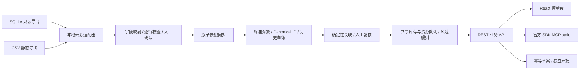

# 架构与业务契约

## 来源、身份与版本

Canonical ID 为来源 ID、实体类型、业务主键的 SHA-256 截断值。禁止仅根据相似名称或相同款号合并订单。业务引用在确定的实体类型内精确匹配；当前企业范围内实体业务主键必须唯一，跨来源碰撞使同步失败。

每次对象变更或映射版本变化创建新 revision；未变化重同步只更新采集时间。删除保留 tombstone，重新出现继续递增历史版本。来源主键、来源表、来源名、源文件更新时间、同步时间和映射版本都保留在对象血缘中。

缺失引用成为动态复核项。人工修正保存目标 Canonical ID、理由、操作者与来源版本；来源记录版本变化后旧修正不再生效。它修正平台关联，不修改原始文件。

## 计算层

事实：订单数量/交期、工单累计完工、工序剩余工时、资源日工时、库存。
规则：按交期和订单号排序，共享资源工时队列，共享库存优先分配，工单拆分数量校验。
推断：估算生产天数、延期天数、缺料风险、追加工时情景。

只有规则条件满足且数据已核实时，风险才为 low/high。任一业务关联缺失会保守地使全局风险 unknown，因为共享产能/库存的其他订单也可能受影响。当前不把 unknown 包装成无风险。所有能力响应附加来源和规则版本；全局分配会受其他订单影响，因此 provenance 包含本次本体全部输入。

## Action Broker

`pending_approval → approved_draft | rejected` 是唯一状态转换。业务建议通过预检后直接进入待审批；`executed` 永远为 false。没有 execute 端点，也没有源数据库写权限。创建使用调用人 + 幂等键约束重复请求，内容不一致返回 409。审批核验当前输入对象集合、版本、复核记录和数据时效；变更后需重建草案。批准和驳回均留存审计。

## API 错误

401 缺失/无效令牌；403 角色或本地访问限制；404 未找到或不可访问对象；409 幂等冲突、已处理状态或审批输入变化；422 请求、来源、映射、数据或业务预检失败。错误同步批次有独立持久失败记录，成功批次与对象更新同一事务提交。

## 开源组件

React / React Flow 提供控制台和图谱，FastAPI / Pydantic 提供 API 与输入校验，SQLAlchemy 支持 SQLite / PostgreSQL 平台存储，[官方 Python MCP SDK](https://github.com/modelcontextprotocol/python-sdk)负责协议。没有重新实现 MCP 协议，也没有伪造 RPA、CDC 或排产求解器能力。
